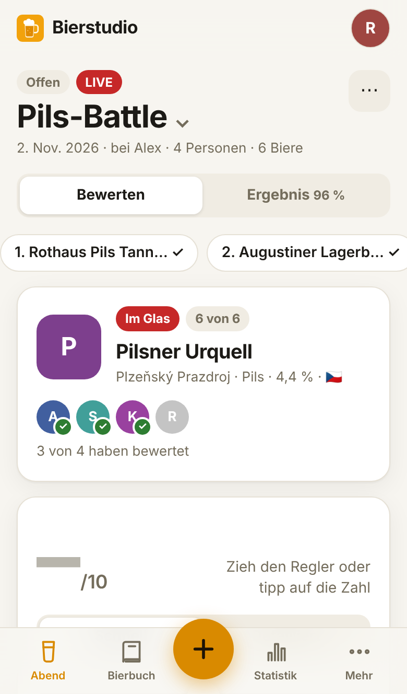
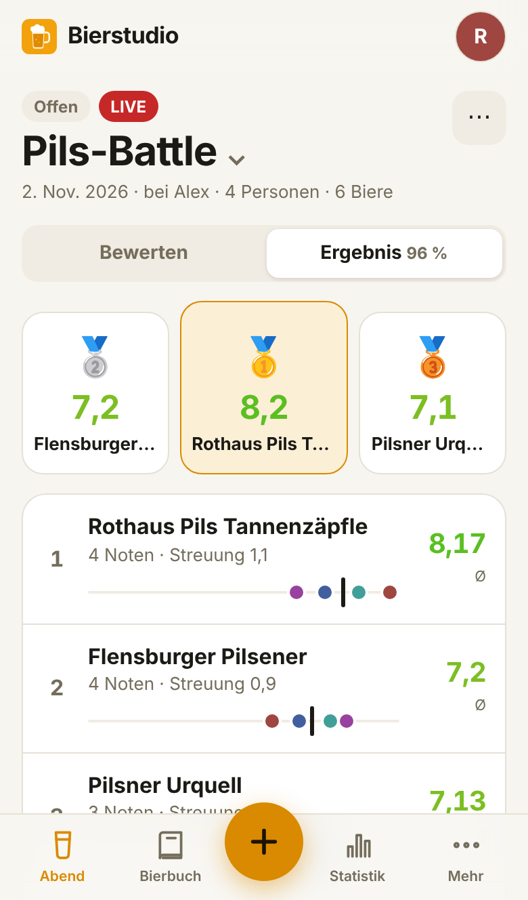
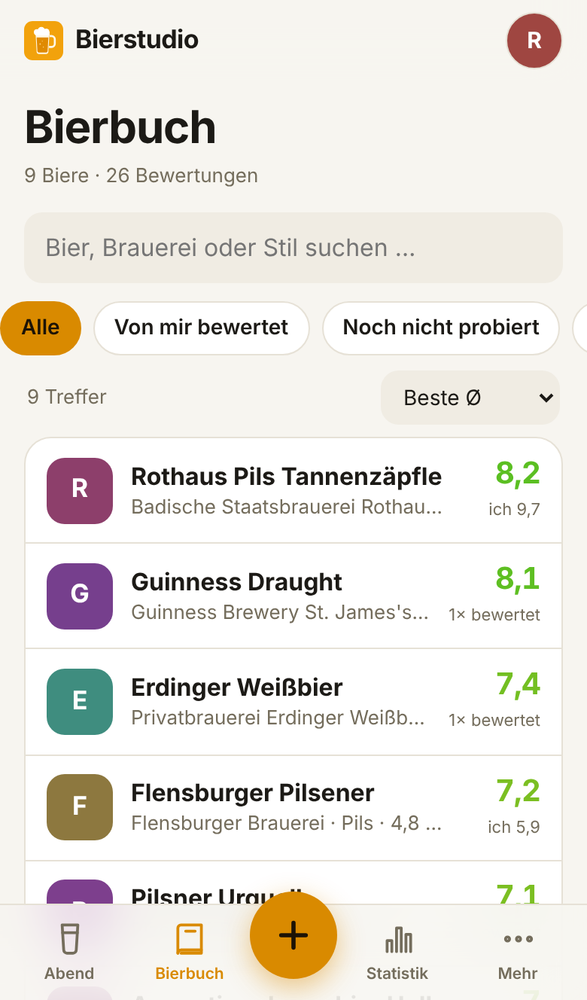
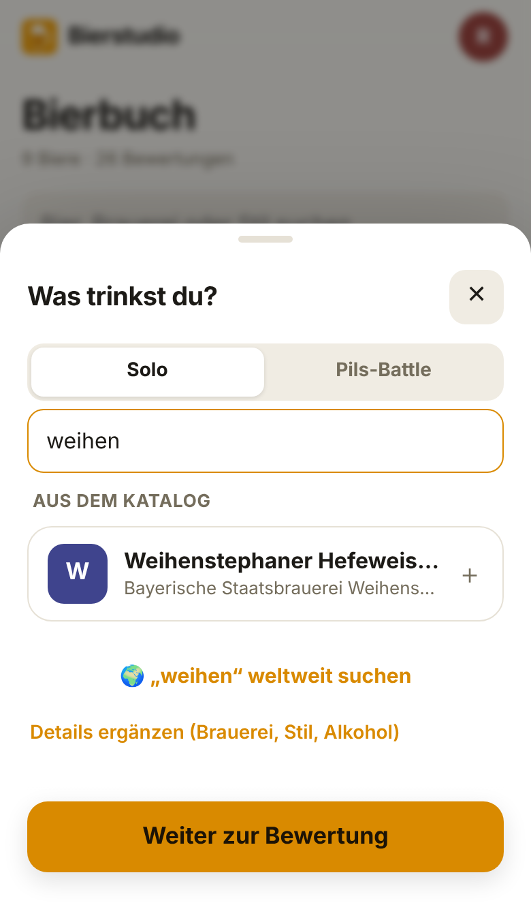
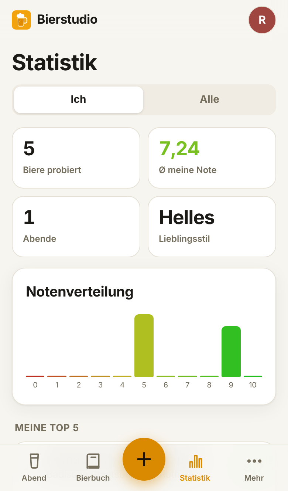
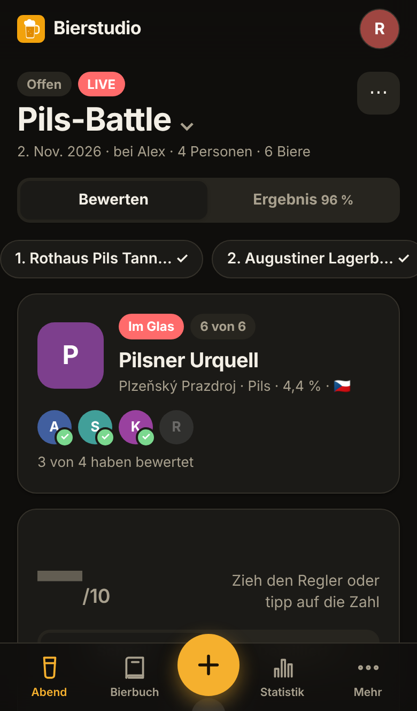

# 🍺 Bierstudio

**Bier gemeinsam oder allein bewerten.** Eine selbst gehostete Web-App für Tasting-Abende mit Freunden und für das Bier zwischendurch. Sie läuft auf Docker oder TrueNAS SCALE und lässt sich auf dem Handy als App installieren.

<p align="center">
  
  
  
</p>

## Funktionen

**Mit Freunden**
- Abend anlegen, alle per **QR-Code** einladen, ohne Konten oder Passwörter.
- Ein Bier **„ins Glas“** setzen: Alle Handys springen automatisch dorthin. Man sieht, wer schon bewertet hat.
- Optional **Blindverkostung**: Biernamen und fremde Noten bleiben bis zur Auflösung verdeckt, auch technisch, nicht nur optisch.
- **Ergebnis** mit Podium, Rangliste, Notenverteilung pro Bier, Matrix und „Gesprächsstoff“ (umstrittenstes Bier, Geschmackszwillinge, strengste Zunge …).

**Allein**
- Über **＋** ein Bier eintragen und sofort bewerten. Es landet im gemeinsamen **Bierbuch**. Trinken die anderen es später auch, bewerten alle dasselbe Bier.
- **Offline-fähig** (über HTTPS): Bewertungen werden ohne Verbindung gespeichert und später synchronisiert.

**Bewerten**
- Schnell (0–10 mit Regler und Feinschritten) oder detailliert (Aussehen, Geruch, Geschmack ×2, Körper, Abgang).
- Eindrücke als Tags (süffig, herb, malzig …), Notiz, Favorit.

**Bierdaten**
- **Hinterlegter Katalog** mit gängigen Bieren: Brauerei, Stil, Alkohol, Land. Er funktioniert offline und kennt Spitznamen wie „Zäpfle“ oder „Sterni“.
- **Weltweite Suche** über [Wikidata](https://www.wikidata.org) und [Open Food Facts](https://world.openfoodfacts.org), auch per Barcode.
- **Brauerei-Logos**: Der Server holt sie und speichert sie lokal zwischen.
- Fehlende Infos lassen sich für alle Biere mit einem Tipp ergänzen.

**Nichts geht verloren, ohne Admin**
- **Rückgängig** nach jedem Löschen, **Papierkorb** (30 Tage) und **Server-Sicherungen**, zu denen jede Person zurückspringen kann.

**Statistik**
- Persönliches Geschmacksprofil, Lieblingsstil, Notenverteilung, Geschmacksverwandtschaft in %, ewige Bestenliste.

<p align="center">
  
  
  
</p>

## Installation

### TrueNAS SCALE (24.10 oder neuer)

1. Ein Dataset anlegen, z. B. `tank/bierstudio`.
2. *Apps → Discover Apps → ⋮ → Install via YAML*, Name `bierstudio`, und das hier einfügen. Den Pfad `/mnt/tank/bierstudio` anpassen:

```yaml
services:
  bierstudio:
    image: ghcr.io/l834-57/bierstudio:latest
    restart: unless-stopped
    ports:
      - "8000:8000"
    volumes:
      - /mnt/tank/bierstudio:/data
    environment:
      TZ: Europe/Berlin
```

3. Die App unter `http://<truenas-ip>:8000` öffnen.

`chown` musst du nicht ausführen: Der Container übernimmt das Dataset selbst für einen eigenen Benutzer (UID 3100). Details, Updates und HTTPS stehen in **[docs/TRUENAS.md](docs/TRUENAS.md)**.

### Docker Compose

```bash
git clone https://github.com/L834-57/bierstudio.git
```
```bash
cd bierstudio
```
```bash
docker compose up -d --build
```

Die Daten liegen anschließend in `./data`.

### Ohne Docker

Python 3.11 oder neuer reicht, weitere Pakete sind nicht nötig:
```bash
python3 app/server.py
```

## Als App aufs Handy

| Zugriff | iPhone | Android/Chrome |
|---|---|---|
| `http://192.168.x.x:8000` | „Zum Home-Bildschirm“ geht (Vollbild, Icon) | nur Verknüpfung, kein Offline-Modus, kein Barcode-Scanner |
| `https://…` | ✓ alles | ✓ Installieren, Offline-Modus, Kamera-Barcode-Scanner |

Offline-Modus und Kamera erlauben Browser nur über HTTPS. Am einfachsten richtest du das mit **Tailscale** (`tailscale serve`) oder einem Reverse Proxy wie Nginx Proxy Manager oder Caddy ein. Mit Tailscale kannst du auch unterwegs bewerten. Anleitung: [docs/TRUENAS.md](docs/TRUENAS.md#https).

## Konfiguration

| Variable | Standard | Bedeutung |
|---|---|---|
| `PORT` | `8000` | Port im Container |
| `DATA_DIR` | `/data` | Ablage für `bierstudio.json`, `backups/` und `logos/` |
| `PUID` / `PGID` | `3100` | Startet der Container als root, übernimmt er `DATA_DIR` für diesen Benutzer und gibt die Root-Rechte dann ab |
| `OFF_CONTACT` | – | Kontakt-E-Mail für Open Food Facts (Barcode-Suche) und Wikidata. Alternativ in der App unter *Mehr*. Die Namenssuche bei Wikidata geht auch ohne. |
| `BACKUP_KEEP` | `60` | Anzahl der aufbewahrten automatischen Sicherungen |
| `TZ` | `Europe/Berlin` | Zeitzone (Image-Variante) |

## Daten & Sicherheit

- **Speicher:** eine JSON-Datei (`bierstudio.json`), atomar geschrieben. Dazu automatische Sicherungen: höchstens alle 10 Minuten bei Änderungen und immer vor dem Löschen oder Wiederherstellen.
- **Papierkorb:** Gelöschte Biere, Abende und Bewertungen lassen sich 30 Tage lang von allen zurückholen.
- **Export:** JSON-Backup und CSV (pro Abend oder alles) unter *Mehr*.
- **Import:** Wiederherstellen akzeptiert auch ältere Formate (`data.json`, `tasting-data.json` der Version 1/2). Liegt eine dieser Dateien beim ersten Start im Datenordner, wird sie automatisch übernommen.
- **Keine Konten:** Personen sind Namen, keine geschützten Accounts. Die App ist für Freunde im eigenen Netz gedacht. **Den Port bitte nicht per Router-Freigabe ins Internet öffnen.** Für den Zugriff von unterwegs eignet sich ein VPN wie Tailscale.
- **Externe Verbindungen** gehen nur vom Server aus: zu Wikidata, Open Food Facts, Wikimedia Commons und den Websites der Brauereien, und nur für Suche und Logos. Die Handys sprechen ausschließlich mit deinem Server. Produktfotos von Open Food Facts sind die einzige Ausnahme, sie lädt der Browser direkt.

## Bierdaten erweitern

Den Katalog pflegst du in [`tools/catalog.tsv`](tools/catalog.tsv), eine Zeile pro Bier. Danach diesen Befehl ausführen:
```bash
python3 tools/build_catalog.py
```
Die Werte sind Richtwerte und können je nach Land oder Jahrgang abweichen. Ergänzungen per Pull Request sind willkommen.

## Entwicklung

Aufbau, Datenformat und API stehen in [docs/ENTWICKLUNG.md](docs/ENTWICKLUNG.md).

## Lizenz & Quellen

- Code: [MIT](LICENSE)
- QR-Codes: [qrcode-generator](https://github.com/kazuhikoarase/qrcode-generator) von Kazuhiko Arase (MIT), mitgeliefert in `app/static/vendor/`
- Bierdaten: [Wikidata](https://www.wikidata.org) (CC0), [Open Food Facts](https://world.openfoodfacts.org) (ODbL)
- Logos: Wikimedia Commons bzw. die Websites der Brauereien. Sie sind Marken ihrer Inhaber und werden nur zur Anzeige zwischengespeichert.
